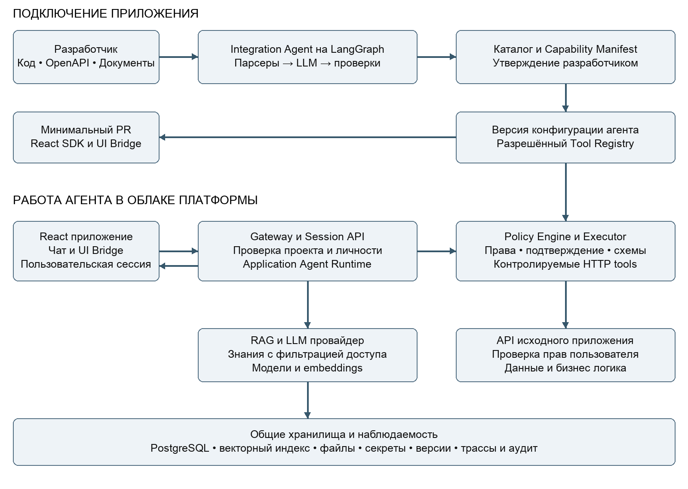
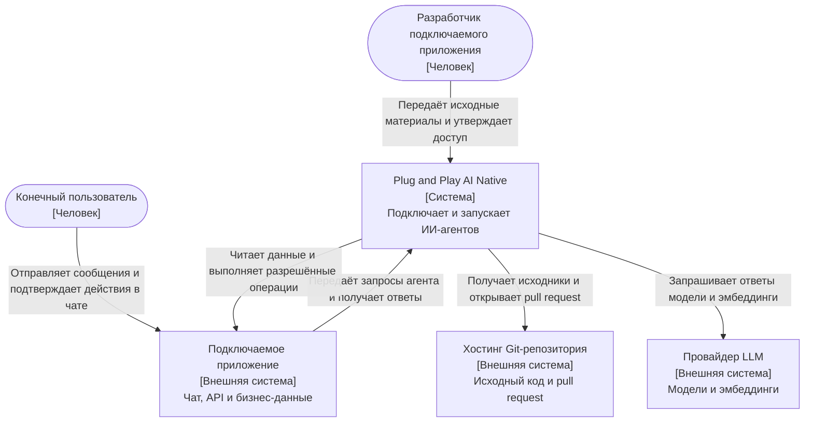
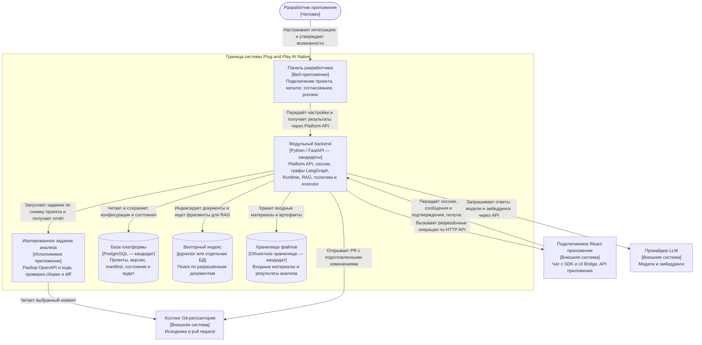

# Plug and Play AI Native

Учебный проект облачной платформы для подключения ИИ-ассистентов к существующим React-приложениям. Платформа анализирует репозиторий и OpenAPI, предлагает разработчику список действий для агента и готовит pull request с чат-виджетом. После подключения ассистент отвечает по документации, получает актуальные данные и выполняет разрешённые действия через API приложения.

- **Разработчику приложения** платформа помогает подключить ассистента, проверить найденные возможности и решить, какие из них разрешить.
- **Пользователю приложения** ассистент помогает решать задачи прямо в чате. Например, найти свою заявку и перенести срок после подтверждения.

## Облачная архитектура

Анализ приложения, исполнение агента, поиск по документации (RAG), политики доступа и журналирование работают на стороне платформы. В React-приложение встраивается чат с тонким адаптером для интерфейса. Данные и бизнес-логика остаются в приложении, а его API проверяет права пользователя на конкретные операции. Внешний поставщик LLM получает только контекст, необходимый для запроса.

### C1 — контекст системы

Plug and Play AI Native показана как одна система. Разработчик подключает приложение через панель платформы, а конечный пользователь работает с агентом через чат в своём приложении. 

Метки в квадратных скобках указывают тип элемента. Стрелка идёт от инициатора взаимодействия к получателю.

### C2 — контейнеры платформы

Возможная структура MVP на основе текущего описания. Внутри рамки показаны приложения и хранилища платформы. Backend объединяет Integration Agent, Runtime, RAG и проверку политики. Анализ исходников и сборка выполняются в изолированных заданиях. 

Прямоугольники внутри рамки обозначают приложения, цилиндры — хранилища. Стрелки показывают, кто инициирует взаимодействие. Векторный индекс может размещаться в PostgreSQL. Способ запуска заданий, доступ к Git, транспорт событий и механизм авторизации предстоит выбрать.

## Два режима работы

- [Integration — подключение приложения](docs/integration.md). От исходников и OpenAPI до утверждённых возможностей, тестового просмотра и pull request.
- [Runtime — работа агента](docs/runtime.md). От сообщения в чате до ответа по документации или результата разрешённого действия.

[Исходное описание проекта](docs/Платформа_ИИ_агентов_проект_для_команды.docx)
